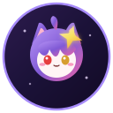

# 星空猫猫 · 电子宠物 (Antigravity Starry Pet)

<p align="center">
  
</p>

<p align="center">
  <b>专属 Google Antigravity 的沉浸式桌面交互伴侣插件</b><br>
  直接内嵌在工作区输入框上方，具备微弹手感、实时多行输入跟随、Token用量监控与个性化语录
</p>

<p align="center">
  
  
  
</p>

---

## ✨ 核心特性

- 🐾 **严丝合缝贴合对话框**：
  - 支持 **端坐垂腿（`dock_sit`）** 与 **趴框探头（`dock_peek`）** 两种精细设计的专属吸附姿态。
  - 精确对齐基准线，手掌与裙摆稳稳贴合输入框顶部边框，小腿或肉垫自然垂挂，绝无悬空与圆角溢出。

- ⚡ **动态自适应多行输入跟随**：
  - 内置高性能 `ResizeObserver` 与位置追踪器。
  - 当你在输入框键入多行文字，输入框随文字向上展开或发送后收缩时，猫猫会**毫厘不差地实时平滑跟随上下移动**。

- 🖐️ **丝滑跟手与自由拖拽摆放**：
  - 基于现代 Pointer Events 与指针捕获（`setPointerCapture`），彻底解决浏览器原生图片拖动虚影与事件丢失问题。
  - 拖拽过程纯像素运算，零强制重排，极度顺滑。
  - 支持在输入框上横向任意拖动调节摆放偏好，亦可拖至屏幕任意角落自由放置（自动切换回站立姿势）。

- 🎵 **即点即响的点按音效与连击收尾**：
  - **按下（Ya1）**：每点击一次瞬间 `0ms` 播放清脆的按压音效，无论手速多快绝不卡顿延迟。
  - **抬起（Ya2）**：连续点击时自动抑制中间杂乱音效，**在最后一次停止点击弹起时，才会顺畅播放一声抬起音效**。
  - **单次点击**：严格遵循先后顺序完整播放（按压响 ➡️ 抬起响），双音绝不重叠。

- 💫 **克制自然的微弹形变**：
  - 点击时伴随自然的轻微受压下沉（`scale(1.08, 0.90)`）与抬起回弹（`scale(0.96, 1.05)`），触感反馈极佳。

- 📊 **Token、缓存与模型用量实时监控**：
  - **左键单击**：唤出浮动气泡，实时展示当前模型、上下文窗口使用率、Prompt 输入、缓存命中率、Completion 输出等数据。
  - **再次点击**：随机切换日常/玩梗对话语录。

- ⚙️ **丰富的右键个性化设置**：
  - 右键点击宠物唤出专属控制面板：
    - 切换吸附姿态（端坐 / 趴框探头）
    - 宠物尺寸自由缩放（60% ~ 150%）
    - 不透明度调节
    - 音效开关、独立音量滑块与在线试听
    - **语录管理**：支持一键导入/导出 JSON 格式自定义日常与玩梗语录，自由增删
    - 关闭伴侣与右下角快速唤出药丸

- 🔔 **任务完成专属语音提醒**：
  - 每次 AI 任务执行完毕，自动播放专属提示音（`task-end-a`）并弹出本次轮次的耗时与 Token 用量报告。

---

## 📂 项目结构

```text
antigravity-pet/
├── plugin.json                 # Antigravity 插件核心清单定义
├── README.md                   # 插件使用与开发说明
├── LICENSE                     # 开源许可证 (MIT)
├── .gitignore
├── assets/
│   ├── logo.svg                # 插件图标
│   ├── quotes.json             # 默认日常与玩梗语录库
│   ├── pet_front.png           # 默认站立立绘
│   ├── pet_dock_sit.png        # 对话框端坐专属立绘
│   ├── pet_dock_peek.png       # 对话框探头专属立绘
│   ├── pet_happy.png           # 开心互动立绘
│   ├── pet_side.png            # 侧身立绘
│   ├── pet_back.png            # 背影立绘
│   └── audio/
│       ├── ya1.mp3             # 按下交互音效
│       ├── ya2.mp3             # 抬起回弹音效
│       └── task-end-a.wav      # 任务完成提醒音
├── sidecars/
│   └── pet/
│       ├── sidecar.json        # 侧边栏常驻服务定义
│       ├── main.mjs            # CDP 自动热注入守护服务
│       ├── pet-runtime.js      # 宠物核心交互与动画运行时 (v2.2.3)
│       └── index.html          # Web 视图入口
└── skills/
    └── antigravity-pet/
        └── SKILL.md            # AI 伴侣能力与工具说明
```

---

## 🚀 安装与使用方法

### 方式一：安装至 Antigravity 全局插件目录

1. 将本仓库克隆至你的 Antigravity 全局插件目录：
   ```bash
   git clone https://github.com/hollywuchi/antigravity-pet.git ~/.gemini/config/plugins/antigravity-pet
   ```
2. 重启 Antigravity，即可在工作区输入框上方看到星空猫猫伴侣！

### 方式二：作为项目/工作区插件启用

1. 在你的项目根目录下创建 `.agents/plugins/` 目录：
   ```bash
   git clone https://github.com/hollywuchi/antigravity-pet.git .agents/plugins/antigravity-pet
   ```
2. 打开该工作区，插件将自动加载。

---

## 🎮 交互指南

| 操作 | 响应效果 |
| :--- | :--- |
| **左键点击** | 唤出用量浮窗，再次点击切换随机日常语录 |
| **快速连点** | 每次按下播放 `Ya1` 音效并微幅压缩，最后抬起播放 `Ya2` 音效并回弹 |
| **鼠标拖动** | 自由移动宠物，可横向微调在对话框上的位置，或放置在桌面边缘 |
| **右键点击** | 打开个性化设置面板（姿态、缩放、透明度、语录导入导出、音量） |
| **任务完成** | 伴侣播放专属完成提示音并展示本次任务 Token 报告 |

---

## 📄 开源许可证

本项目基于 [MIT 许可证](LICENSE) 开源。欢迎提 Issue 与 PR！
